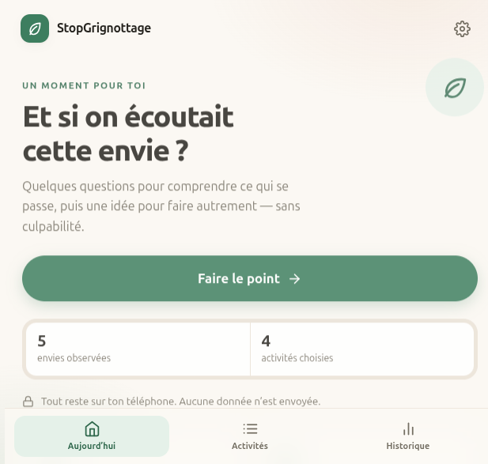
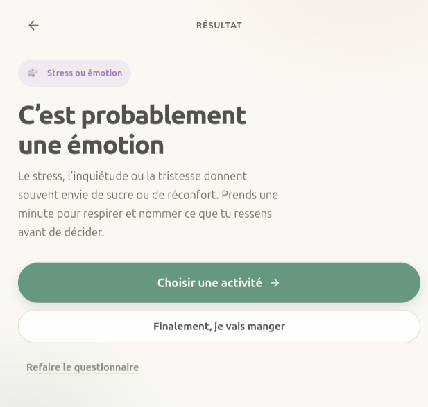
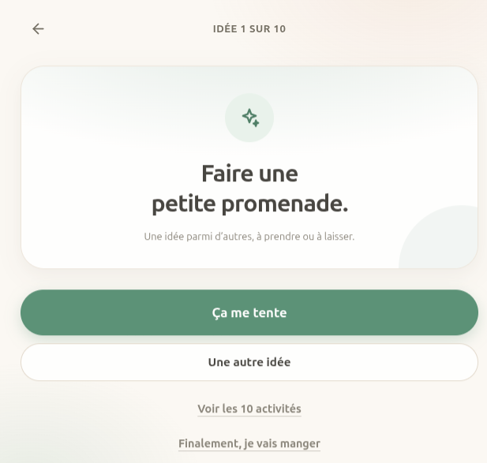
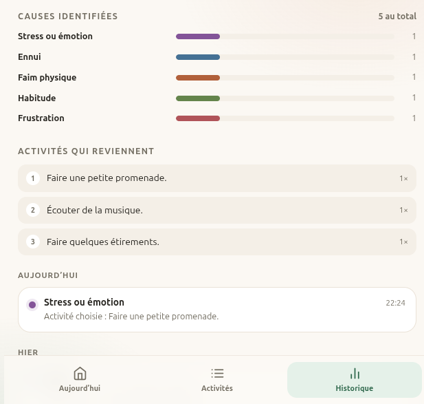
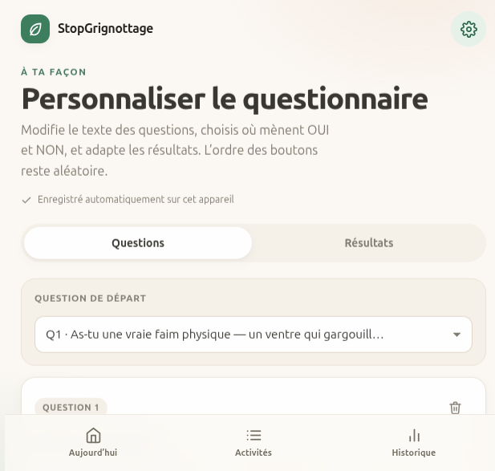

# 🌿 StopGrignottage

**Comprendre ses envies de grignoter, puis trouver une autre idée — sans culpabilité.**

StopGrignottage est une petite application mobile qui pose quelques questions pour identifier ce qui se cache derrière une envie de grignoter : une vraie faim, de l'ennui, de la frustration, une émotion, une habitude… Puis elle propose une activité simple, à prendre ou à laisser.

- **Aucun compte**, aucun serveur, aucune publicité.
- **Toutes les données restent sur le téléphone** (stockage local du navigateur).
- **Fonctionne hors connexion** une fois installée.
- **Installable sur Android** depuis Chrome, ou avec l'**APK** fourni.

> L'application n'est pas un régime et ne remplace pas un professionnel de santé. C'est un outil d'observation, à utiliser sans pression.

---

## 📸 Aperçu

<p align="center">
  
  
  
</p>
<p align="center">
  
  
  
</p>

---

## 📲 Installer sur Android

L'application est publiée sur GitHub Pages :

**<https://manonlacombe.github.io/stopgrignottage/>**

1. Ouvrir le lien avec **Chrome** sur le téléphone.
2. Appuyer sur le bouton **« Installer sur ton téléphone »** s'il apparaît.
3. Sinon : menu **⋮** de Chrome → **Ajouter à l'écran d'accueil**.
4. L'icône apparaît ensuite avec les autres applications. Elle s'ouvre en plein écran et fonctionne sans Internet.

---

## 🤖 APK Android (installation directe)

Pour installer l'app sans passer par Chrome, un APK signé est disponible :

**<https://github.com/ManonLacombe/stopgrignottage/raw/main/StopGrignottage.apk>**

<p align="center">
  
  <br>
  <sub>À scanner avec l'appareil photo du téléphone</sub>
</p>

1. Scanner le QR code, ou ouvrir le lien depuis le téléphone.
2. Chrome télécharge `StopGrignottage.apk` (44 Ko).
3. Ouvrir le fichier, puis **Installer**. Android demande d'autoriser les applications de sources inconnues pour Chrome : accepter.
4. L'app s'installe avec sa propre icône, comme les autres.

L'APK est un **conteneur natif** : il affiche l'application publiée sur GitHub Pages en plein écran, sans barre d'adresse, et garde ses données locales sur le téléphone. La première ouverture demande Internet ; ensuite le service worker permet de fonctionner hors ligne.

---

## ✨ Ce que fait l'application

### Le questionnaire
- Un arbre de décision qui distingue **six causes possibles** : faim physique, ennui, frustration, stress ou émotion, habitude, envie indéterminée.
- Les boutons **OUI** et **NON** changent de côté à chaque question, pour éviter de répondre machinalement.
- Un résultat explique la cause probable, avec un message bienveillant et deux issues : manger, ou essayer une activité.

### Les activités
- **10 activités par défaut**, sans catégories, proposées dans un ordre aléatoire.
- Une activité à la fois : **« Ça me tente »** ou **« Une autre idée »**.
- Une activité refusée n'est pas reproposée pendant le tour.
- Quand tout a été refusé, **toutes les activités sont affichées ensemble** pour choisir directement.
- **« Ajouter une activité »** ouvre une fenêtre de saisie ; la nouvelle idée apparaît dans la liste et est enregistrée.
- Un **éditeur complet** permet d'ajouter, renommer et supprimer les activités.

### L'historique et les statistiques
- Chaque questionnaire terminé enregistre : **date et heure**, **cause identifiée**, **décision finale** (manger ou choisir une activité) et **activité retenue**.
- Seule l'activité finalement choisie est enregistrée, jamais les activités refusées.
- Statistiques locales : nombre d'envies observées, activités choisies, fois où tu as choisi de manger, répartition par cause, activités qui reviennent le plus.
- Historique groupé par jour, avec possibilité de tout effacer.

### Le questionnaire personnalisable
- Ajouter, modifier ou supprimer des **questions** et des **résultats**.
- Modifier les **branchements OUI / NON** et la **question de départ**.
- Les boucles sont détectées et bloquées ; une question ou un résultat utilisé par un branchement ne peut pas être supprimé.
- Possibilité de **rétablir le questionnaire d'origine** sans toucher aux activités ni à l'historique.

---

## 💾 Données et confidentialité

- Stockage dans le **`localStorage`** du navigateur, sous la clé `stopgrignottage.v1`.
- Aucune requête vers un serveur, aucun compte, aucun traceur.
- Les données peuvent être effacées en supprimant les données du site dans Chrome, ou via le bouton **« Effacer tout l'historique »**.
- Les activités et les questions personnalisées sont conservées séparément de l'historique.

---

## 🛠️ Développement local

Aucune compilation, aucune dépendance. Un simple serveur statique suffit (le service worker exige `http://`, pas `file://`) :

```bash
cd StopGrignottage
python3 -m http.server 8000
```

Puis ouvrir <http://localhost:8000>.

Pour tester le mode hors ligne : charger la page une première fois, puis couper le réseau et recharger.

### Reconstruire l'APK

Le conteneur Android (une activité, un WebView, aucun autre code) vit dans `android/` et se compile **sans Gradle ni Android Studio** :

```bash
cd android
./build.sh
```

Prérequis : SDK Android (build-tools 34, platform android-34) et un JDK 17 ou plus. Le script enchaîne `aapt2`, `javac`, `d8`, `zipalign` et `apksigner`, puis copie l'APK à la racine du dépôt.

La clé de signature est créée au premier lancement dans `android/signing/` (exclue de git). **Conserve-la et sauvegarde-la** : une mise à jour doit être signée avec la même clé pour pouvoir s'installer par-dessus l'app déjà présente.


---

## 🚀 Publication sur GitHub Pages

Le site est prévu pour être servi depuis la branche `main`, à la racine du dépôt :

1. Dépôt GitHub → **Settings** → **Pages**.
2. **Source** : *Deploy from a branch*.
3. **Branch** : `main`, dossier `/ (root)`.
4. Enregistrer. Le site est publié à l'adresse `https://<utilisateur>.github.io/stopgrignottage/`.

À chaque modification poussée sur `main`, GitHub Pages republie automatiquement l'application. Penser à changer la version du cache dans `sw.js` (`CACHE_NAME`) lors d'une mise à jour importante, pour que les téléphones récupèrent la nouvelle version.

---

## 📁 Structure

```text
index.html              Structure de l'application
styles.css              Design mobile-first, thèmes clair et sombre
app.js                  Questionnaire, activités, historique et éditeurs
manifest.json           Configuration PWA (installation Android)
sw.js                   Service worker (fonctionnement hors connexion)
icons/                  Icônes de l'application
docs/                   Captures d'écran pour le README
qrcode.png              QR code de téléchargement de l'APK
StopGrignottage.apk     APK Android signé (conteneur natif de l'app web)
android/                Source du conteneur Android + script de compilation
README.md               Ce document
```

### Notes techniques
- **Vanilla JS**, aucun framework, aucune ressource externe (polices système, icônes SVG intégrées).
- Interface en français, accessible au clavier, avec `aria-live` pour les changements d'écran.
- Thème clair et thème sombre automatiques (`prefers-color-scheme`).
- Navigation intégrée à l'historique du navigateur : le bouton Retour d'Android fonctionne.
- Données versionnées (`schemaVersion: 1`) et validées au chargement ; en cas de données corrompues, les valeurs par défaut sont restaurées.

---

## 🗺️ Feuille de route

- [x] Questionnaire à arbre de décision, boutons OUI/NON aléatoires
- [x] Résultats explicatifs et bienveillants
- [x] 10 activités proposées une par une, sans répétition
- [x] Affichage de toutes les activités après refus
- [x] Ajout d'une activité depuis le parcours
- [x] Sauvegarde locale permanente des activités
- [x] Éditeur d'activités (ajouter, modifier, supprimer)
- [x] Historique local (date, cause, décision, activité choisie)
- [x] Statistiques locales
- [x] Questionnaire modifiable dans l'application
- [x] APK Android signé, avec QR code de téléchargement
- [ ] Export / import des données (piste pour une prochaine version)

---

## 📄 Licence

Projet personnel. Les icônes SVG sont inspirées de [Feather Icons](https://feathericons.com/) (MIT).
